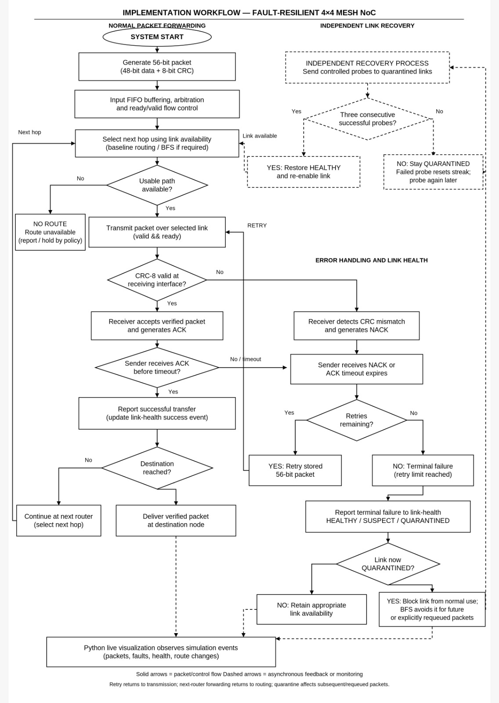
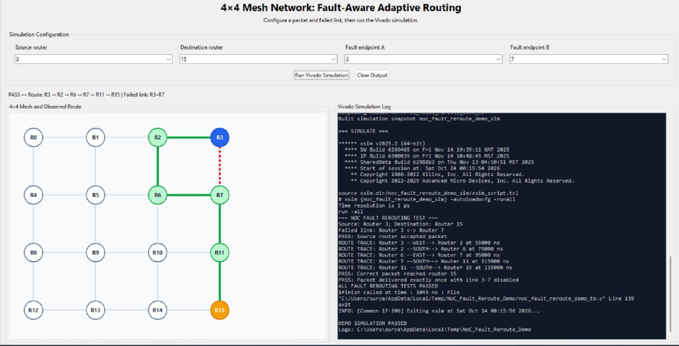

# Fault-Resilient 4x4 Mesh Network-on-Chip
### With Adaptive Routing and Autonomous Link Recovery

A Verilog-based Network-on-Chip (NoC) project exploring reliable on-chip communication through CRC-based error detection, bounded retransmission, link-health monitoring, fault-aware routing and probe-based link recovery.

---

## 1. Problem Statement

As modern System-on-Chip (SoC) designs integrate increasing numbers of processors, memory units and specialised hardware components, traditional bus-based communication becomes less scalable. Network-on-Chip (NoC) architectures address this challenge by using routers and communication links to provide structured data transfer between components.

However, NoC communication can still experience packet corruption, congestion and link failures. Conventional fixed-routing approaches may continue attempting to use unreliable communication paths, resulting in repeated transmission failures, increased latency and interrupted communication.

This project explores a fault-resilient 4x4 mesh NoC capable of detecting communication errors, managing retransmissions, monitoring link health and selecting alternative routes around unavailable links. It also investigates probe-based link recovery so that repaired links can potentially rejoin the network without restarting the entire system.

**Primary objective:** Maintain reliable communication between network nodes despite temporary communication-link failures.

## 2. Motivation

Correct data transfer is as important as computation in a digital system. A communication failure affecting one part of an interconnected architecture should not necessarily interrupt the operation of the entire network.

The motivation behind this project is to develop a network that can identify unreliable communication links and respond through error detection, retransmission, link-health monitoring and alternative route selection.

The project brings together several important digital-design concepts:

- Router architecture and packet switching
- FIFO buffering and arbitration
- Finite State Machines (FSMs)
- CRC-based error detection
- ACK/NACK-based retransmission
- Link-health monitoring and fault management
- Weighted shortest-path routing
- Probe-based link recovery

The design is implemented in Verilog HDL and verified through simulation using AMD Vivado and XSim.

## 3. System Architecture

The network uses a two-dimensional 4x4 mesh topology.

| Specification | Value |
|---|---:|
| Network dimensions | 4 x 4 |
| Number of routers | 16 |
| Undirected neighbour connections | 24 |
| Directed channels | 48 |
| Router ports | 5 |
| Packet width | 56 bits |
| Input FIFO depth | 4 |

Each router has five ports: North, South, East, West and Local.

Router IDs range from 0 to 15 and are assigned row-wise:

`router_id = 4 * y + x`

The X coordinate increases eastward and the Y coordinate increases southward.

### Major subsystems

| Subsystem | Responsibility |
|---|---|
| CRC generator and checker | Packet integrity verification |
| Receiver wrapper | Packet validation and duplicate suppression |
| Retransmission manager | ACK/NACK handling and bounded retries |
| Link-health manager | Healthy, Suspect and Quarantined states |
| Link-recovery controller | Probe-based recovery |
| Recovery adapter | Recovery-to-router interface |
| Input FIFO | Packet buffering |
| Arbiter | Selection among competing input requests |
| Five-port router | Packet forwarding and flow control |
| 4x4 mesh | Inter-router connectivity and fault injection |
| Adaptive routing module | Weighted shortest-path route selection |

## 4. Implementation Workflow
### System Workflow

The following flowchart illustrates the packet transmission process, including CRC verification, acknowledgement handling, retransmission and link recovery.



### 1. Packet Generation and Injection

A packet contains the source router ID, destination router ID, packet ID, payload and CRC-8 checksum. The packet is injected into the source router for communication through the mesh.

### 2. Router Buffering and Arbitration

Each router uses input FIFOs to temporarily store incoming packets. Arbitration selects among pending requests for an output port. Ready/valid handshaking controls transfers and prevents packet loss when downstream modules are not ready.

### 3. Route Selection

The router supports deterministic XY routing and adaptive routing. In the 4x4 mesh, routers are instantiated with ADAPTIVE_ROUTING enabled. The mesh-level fault_enable signal selects between the two routing modes.

When fault_enable is asserted, routers use the weighted Dijkstra shortest-path algorithm and the link-availability map generated by the mesh fault-injection logic. When it is deasserted, routers use deterministic XY routing.

The routing module accepts congestion information, but the current 4x4 mesh supplies an all-zero congestion map. Therefore, live congestion-aware routing is not yet active at the mesh level.

### 4. Packet Transmission and Error Detection

Packets are transmitted through the selected communication links. The receiving side uses a CRC-8 checker to validate packet integrity. A corrupted packet is rejected and negative acknowledgement feedback is generated by the protected-link recovery subsystem.

### 5. Acknowledgement and Retransmission

The recovery subsystem uses ACK/NACK feedback and timeout detection to manage transmission failures. Unsuccessful or unacknowledged transmissions can be retried up to a configured limit.

### 6. Link-Health Monitoring

The link-health manager classifies links into three states:

- **Healthy:** Link is available for communication.
- **Suspect:** Repeated failures have been observed.
- **Quarantined:** Link is considered unavailable.

The state transitions are controlled by configurable failure and recovery thresholds.

### 7. Fault-Aware Adaptive Routing

The routing module uses the mesh-generated link-availability map to avoid connections disabled by configured fault injection. The 4x4 mesh passes fault_enable to the routers as adaptive_enable, so fault-aware routing is selected when fault injection is enabled.

This fault-injection mechanism is not yet automatically driven by the separate link-health manager's quarantine output.

### 8. Link Recovery

The recovery controller supports probe-based recovery. Successful probes contribute towards restoring a quarantined link to service. A link can return to the healthy state after satisfying the configured recovery condition.

### 9. Simulation and Visualisation

The design is simulated using AMD Vivado and XSim. A Python-based visualisation tool provides a graphical representation of the mesh, source and destination selection, fault configuration and route behaviour.

## 5. Technical Specifications

### Packet format

The network uses a 56-bit packet.

| Bits | Field | Width |
|---|---|---:|
| [55:52] | Source router ID | 4 |
| [51:48] | Destination router ID | 4 |
| [47:40] | Packet ID | 8 |
| [39:8] | Payload | 32 |
| [7:0] | CRC-8 | 8 |

### CRC configuration

| Parameter | Value |
|---|---|
| Polynomial | `0x07` |
| Initial remainder | `0x00` |
| Processing order | MSB first |
| Protected data | `packet[55:8]` |

### Recovery configuration

| Parameter | Value |
|---|---:|
| Suspect threshold | 2 |
| Quarantine threshold | 4 |
| Successful recovery probes | 3 |
| Retransmission timeout | 16 clock cycles |
| Maximum retries | 3 |

### Routing configuration

The adaptive routing implementation uses a link cost based on endpoint congestion:

`Link cost = 1 + 2 x max(endpoint congestion scores)`

The routing module considers link availability and congestion when computing a weighted shortest path.

**Implementation note:** The module is historically named `mesh_bfs_route`, but its implemented algorithm is weighted Dijkstra, not breadth-first search.

## 6. Verification and Testing

The repository contains dedicated testbenches for recovery modules, routers, mesh behaviour and adaptive routing.

### Adaptive routing testbenches

- `mesh_bfs_route_tb.v`
- `mesh_bfs_congestion_tb.v`
- `mesh_bfs_fault_tb.v`
- `mesh_bfs_no_route_tb.v`
- `mesh_bfs_path_tb.v`
- `mesh_bfs_route_regression_tb.v`
- `mesh_bfs_trace_tb.v`

These cover route selection, congestion-dependent decisions, failed-link avoidance, unreachable destinations, path traversal and regression scenarios.

### Recovery testbenches

- `tb_crc8.v`
- `tb_crc8_checker.v`
- `tb_link_health_manager.v`
- `tb_link_recovery_controller.v`
- `tb_link_rx_wrapper.v`
- `tb_protected_link.v`
- `tb_recovery_advanced.v`
- `tb_recovery_integration.v`
- `tb_recovery_router.v`
- `tb_retransmission_extended.v`
- `tb_retransmission_handshake.v`
- `tb_retransmission_manager.v`
- `tb_router_recovery_adapter.v`

### Router and mesh testbenches

- `noc_4x4_tb.v`
- `noc_backpressure_tb.v`
- `noc_fault_reroute_demo_tb.v`
- `noc_fault_reroute_tb.v`
- `noc_stall_stress_tb.v`
- `noc_stress_tb.v`
- `router_5port_tb.v`
- `router_contention_tb.v`
- `router_fifo_test_tb.v`

### Test execution

The project uses AMD Vivado 2025.2 and XSim.

PowerShell test runners are provided:

| Script | Purpose |
|---|---|
| `run_bfs_tests.ps1` | Adaptive routing verification |
| `run_fault_reroute_test.ps1` | Fault-aware rerouting verification |
| `run_noc_demo_test.ps1` | NoC demonstration simulation |

The scripts may require adjustment for a different Vivado installation. Check their configured paths and branch requirements before execution.

The Python visualisation application is provided in `noc_demo_gui.py`.
### Simulation Evidence

The following Vivado XSim waveform captures the NoC simulation and demonstrates packet-level activity during verification.



## 7. Repository Structure

```text
fault-resilient-noc/
|
+-- docs/
|   +-- interface_contract.md
|
+-- rtl/
|   +-- recovery/
|   |   +-- crc8.v
|   |   +-- crc8_checker.v
|   |   +-- link_health_manager.v
|   |   +-- link_recovery_controller.v
|   |   +-- link_rx_wrapper.v
|   |   +-- retransmission_manager.v
|   |   +-- router_recovery_adapter.v
|   |
|   +-- router/
|   |   +-- arbiter.v
|   |   +-- input_fifo.v
|   |   +-- noc_4x4.v
|   |   +-- router_5port.v
|   |
|   +-- routing/
|       +-- mesh_bfs_route.v
|
+-- tb/
|   +-- Recovery, router, mesh and routing testbenches
|
+-- run_bfs_tests.ps1
+-- run_fault_reroute_test.ps1
+-- run_noc_demo_test.ps1
+-- noc_demo_gui.py
```

## 8. Tools and Technologies

- Verilog HDL
- AMD Vivado 2025.2
- XSim
- Python 3
- PowerShell
- Git and GitHub

## 9. Current Limitations and Future Work

The following areas remain important for further development:

1. Connect live router congestion measurements to the adaptive routing input.
2. Integrate link-health quarantine status directly with the mesh link-availability map.
3. Complete end-to-end integration of recovery events and adaptive route selection.
4. Extend verification to simultaneous traffic and multiple concurrent link failures.
5. Analyse deadlock and livelock behaviour under adaptive routing.
6. Evaluate end-to-end packet delivery, latency, throughput and recovery performance.
7. Improve transaction identification for delayed ACK/NACK feedback and packet-ID reuse.

The routing algorithm's ability to find a shortest available path does not by itself guarantee deadlock freedom in the complete network.

## 10. Team Contributions

| Contributor | Primary responsibility |
|---|---|
| Surya Karthick | Error detection, retransmission, link health and recovery |
| Rahul Balamurugan | Router architecture, FIFOs, arbitration and mesh integration |
| Adwaith Raju | Adaptive routing and route-selection logic |

## 11. Development Workflow

Subsystems are developed on separate feature branches and integrated through `integration/system`.

Relevant regressions should be executed after RTL or interface changes. Changes should be reviewed and verified on the integration branch before being merged into `main`.

---

**Project:** Fault-Resilient 4x4 Mesh Network-on-Chip with Adaptive Routing and Autonomous Recovery  
**Implementation:** Verilog HDL  
**Simulation:** AMD Vivado 2025.2 / XSim

